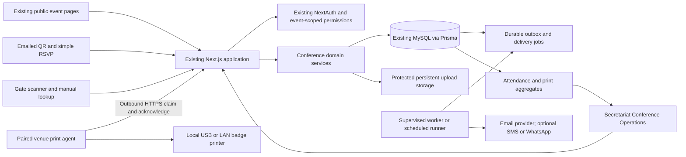

# Conference Operations module: discovery and integration proposal

Review date: 11 October 2026. Status: architecture proposal; implementation has not started.

## Recommendation

Add Conference Operations to the existing FFDGN modular monolith. Keep Next.js, TypeScript, Prisma, MySQL, NextAuth and the current Secretariat console. Extend the existing `ForumEvent` and `EventRegistration` models instead of creating a second event application, database or login system. Introduce a separate local print agent because cloud hosting cannot directly reach USB printers at a venue.

The attachment's NestJS/PostgreSQL stack is a conditional suggestion, not a reason to replace working infrastructure. A separate subdomain adds session, origin, deployment and support complexity without solving the key operational problems. Consider separating the operations runtime later only if measured traffic or hosting constraints justify it; retain the same event and identity sources.

### Confirmed primary workflow: already-invited guests

The user confirmed that formal invitations have already been sent to high-profile and important guests. Staff upload that approved guest list, review import errors/duplicates, and send each guest a personalized email containing their event QR code and an RSVP link. Upload creates the event registration internally; guests do not complete a registration form or create an account. This email supplies the digital entry credential and RSVP facility for the existing invitation, rather than asking guests to apply for attendance again.

The QR code is issued and included in the email immediately, with a downloadable invitation/badge-entry PDF option. It is not withheld until an RSVP response. RSVP is a simple accept/decline action for planning; the guest can present the emailed QR at arrival. Default admission permits an active invited guest with a pending RSVP. Explicitly declined guests are flagged for operator review, while cancelled/revoked credentials are rejected. Any stricter RSVP requirement must be an explicit event setting, not a hidden dependency of QR delivery.

Public self-registration remains an available feature, disabled by default for these events. Both its page and mutation API must enforce the event's registration mode. Staff can add or correct guests manually without requiring action from the guest. VIP/VVIP categories and access privileges are assigned by authorized staff, not by recipients.

## 1. Evidence and current capabilities

This review inspected repository source and deployment documentation. It did not connect to production, verify cPanel services, execute existing smoke tests, or establish that the prepared release is deployed.

| Area | Existing implementation | Integration consequence |
| --- | --- | --- |
| Web and API | `package.json`: Next.js 16.3.8, React 18.3.1, TypeScript; App Router pages and route handlers | Build screens and APIs in the same application; dependency compatibility needs normal build verification during implementation |
| Styling | Tailwind 3.4; Inter and Cormorant Garamond; forest green, gold and paper tokens | Preserve brand and console components; use Inter for dense operational screens |
| Database | Prisma 5.22, MySQL provider, UUID identifiers, versioned migrations | Use additive MySQL migrations; do not introduce PostgreSQL |
| Identity | Credentials login, bcrypt, JWT sessions, database checks for account deactivation/password changes, login throttling and lockout | Reuse staff accounts; visitors need attendee records, not login accounts |
| Authorization | `lib/auth.ts` capabilities; `lib/server-auth.ts` operation guards; `proxy.ts` route guards | Add event assignments and restricted operational roles; current permissions are global |
| Event CMS | `ForumEvent`, programme rows, speakers, related documents, media and public event pages; audited CMS routes | Keep existing IDs, slugs and public content relationships |
| Registration | `EventRegistration` requires `User`; unique user/event pair; Registered/Cancelled status; portal registration endpoints | Extend for guests while preserving member registration API behavior |
| Guest list | `ForumEvent.guestList` is free-form editorial text | It is not an attendee registry and must not be silently converted into verified attendees |
| Notifications | Database-backed `Notification` for signed-in portal users | This is not email/SMS delivery; add external delivery adapters and durable jobs |
| Storage | Persistent `UPLOAD_DIR`, media upload validation and private document streaming | Reuse validation/storage patterns; guest photos, imports and generated private invitations need protected routes |
| Redis | ioredis used for rate limiting; local Docker Redis disables persistence | Redis exists, but no durable delivery queue or worker implementation was found |
| Deployment | Next standalone package, Node 22, Linux Prisma/sharp targets, cPanel/Passenger instructions | Preserve packaging; background processes and long-lived connections need host validation |
| Security | Nonce CSP, private cache headers, global `camera=()`, production `connect-src 'self'` | Camera scan needs route-specific camera permission; direct localhost printer bridges would need narrow CSP changes |
| Audit | Existing append-only table design; `audit()` catches write failures; actor is a required User | Critical conference mutations need transactional audit records; anonymous RSVP/delivery needs a separate actor-aware journal |
| Verification | Typecheck/lint/build, links, smoke scripts, CSP and rate-limit checks | Reuse checks and add meaningful concurrency, access and physical-print validation |

`deploy/REPORT.md` records a prepared package dated 3 October, restoration of 36 tables/731 rows and local smoke checks. It explicitly leaves Linux execution and Passenger integration unverified. Source and production schema parity therefore remain an implementation prerequisite.

No QR generation, scanner library, badge renderer, printer agent, SMTP transport, spreadsheet parser or queue worker was found in the inspected dependency manifest and relevant source searches. Monitoring, CI and backup execution are not established by the deployment report.

## 2. Architecture and module boundary

Suggested source structure:

- `lib/conference/`: authorization, registrations, invitations, check-in, badge rendering, imports, reporting and job transitions.
- `components/conference/`: reusable event switcher, guest tables, scanner feedback, badge preview and printer status.
- `/admin/events/[slug]/operations`: overview, guests, invitations, sessions, gates, staff, badge templates, printers and reports.
- `/gate/[slug]`: dedicated authenticated gate workspace with minimal public-site chrome. Add explicit proxy/page guards and private headers; the route does not currently exist.
- `/events/[slug]/register`: optional public registration.
- `/invite`: guest invitation/RSVP entry; exchange a capability token for a short-lived scoped session and remove the token from the visible URL.
- `/api/v1/conference/*`: module APIs; existing CMS and portal endpoints remain compatibility interfaces.
- `print-agent/`: separately packaged native venue process, not a process spawned by a web request.

Use API handlers as thin adapters over server-side domain services. Reuse existing response/error conventions. Operational writes and guest views must fail explicitly when MySQL is unavailable; never use editorial preview data as live attendance.

### Infrastructure choices

Start with MySQL-backed durable jobs and an outbox, leased by a supervised worker or bounded scheduled runner. This avoids treating the current nonpersistent Redis rate-limit service as a delivery queue. Every committed invitation/check-in and its job must share one database transaction. Retries use idempotency keys, retry limits, backoff and a dead-letter state.

Prefer a supervised worker for prompt delivery. A host-supported scheduled runner is a fallback with measurable delivery delay, authenticated invocation, overlap prevention and bounded execution. Do not rely on Next.js request timers to finish jobs after a response. If the host supports persistent Redis and workers, BullMQ becomes an optional alternative with an explicit durable Redis configuration and deployment process.

Start the dashboard with incremental authenticated polling, proposed at 2–5 seconds. Introduce SSE only after Passenger buffering, connection lifetime and capacity have been tested. Dashboard reads use indexed queries; check-in must not wait for a broadcast or provider call.

## 3. Feature breakdown

| Module | Scope | MVP boundary |
| --- | --- | --- |
| Event operations | Operational lifecycle, dates/timezone, venue, capacity, deadline, registration mode, branding, archive/duplicate | Invitation-only by default; optional public registration; reuse event CMS; duplicate configuration without guests, credentials or attendance |
| Guests | Shared attendee directory, categories, organizations, imports, validation, search and event registrations | CSV with preview/errors first; Excel next; companions get individual registrations |
| Invitations | Branded templates, opaque credentials, email, resend, expiry, revoke/regenerate and protected downloads | Email the QR and RSVP link to already-invited uploaded guests; downloadable QR/PDF; SMS/WhatsApp optional |
| RSVP | Accept/decline, confirmation, QR retrieval, companion limit | No guest account or registration form; QR available before response; explicit separate RSVP and attendance states |
| Gate | Keyboard scanner, camera scanner, manual search, validation, concurrent check-in and controlled override | Online event admission first; configurable automatic/confirmed admission |
| Badge/printing | Category templates, dimensions, preview, issuance, agent pairing, job status, reprints | One physically validated printer/OS/media combination; PDF office-printer fallback |
| Dashboard/reports | Invited, confirmed, admitted, expected, VIP arrivals, gate/category/time and print status | Polling, indexed summaries and CSV first; Excel/PDF exports next |
| Security/operations | Event-scoped staff, audit, rate limits, retention, diagnostics and runbooks | Backend enforcement, production migration/recovery plan and incident exercises |
| Advanced operations | Session/zone admission, re-entry, offline synchronization, drag/drop designer | Later releases after online end-to-end reliability |

Avoid modeling Checked In as an invitation status. Invitation lifecycle, transport delivery, RSVP and attendance are independent facts.

## 4. Proposed normalized relational schema

This is a logical schema, not an executable migration. Unless specified otherwise, new entities have UUID primary keys and created/updated timestamps. All foreign keys require matching indexes. Every event-owned resource must be checked against its event, including gate, station, template, session and printer references.

| Entity | Keys, relationships and main fields | Constraints/indexes |
| --- | --- | --- |
| Existing `User`, `Member`, `AuditLog` | Reuse institutional identities and memberships | Preserve existing constraints; attendee links are optional |
| `GuestOrganization` | id, name, optional external reference | Index normalized name; matching requires review rather than forced name uniqueness |
| Existing `ForumEvent` | Existing public content stays authoritative | Preserve slug uniqueness and existing joins |
| `ConferenceConfig` | eventId PK/FK, operationsEnabled, lifecycle Draft/Published/Archived, registrationMode default InvitationOnly, requireAcceptedRsvp default false, timezone, startsAt/endsAt UTC, venueId, capacity, reservedCount, registrationDeadline, reentryPolicy, autoCheckIn, retention settings | One row/event; enforce public-registration mode on page/API; validate time/deadline ordering; lifecycle separate from Upcoming/Ongoing/Past |
| `Venue` | name, address, city, timezone | Referenced by config; existing event venue/city remain public compatibility fields |
| `Attendee` | name, normalizedEmail nullable, normalizedPhone nullable, guestOrganizationId nullable, jobTitle, photoStorageKey, userId nullable unique, memberId nullable unique | Index email/phone; do not globally require unique email because shared addresses and companions exist; controlled merge workflow |
| Existing `EventRegistration`, extended | Existing userId becomes nullable; attendeeId added, categoryId, operationalStatus, invitedAt, checkedInAt, organization/title display overrides | Preserve unique(userId,eventId); add unique(attendeeId,eventId); attendeeId becomes required after backfill; retain Registered/Cancelled compatibility field during transition |
| `RegistrationCompanion` | sponsorRegistrationId, companionRegistrationId, both same event | Unique companionRegistrationId; no self/cycles; enforce event and companion limit transactionally |
| `EventCategory` | eventId, code, label, badgeTemplateId nullable | Unique(eventId,code); defaults VIP/VVIP/Speaker/Delegate/Sponsor/Media/Staff/General |
| `EventSession` | eventId, title, startsAt, endsAt, venue/room, capacity | Index(eventId,startsAt); operational schedule separate from editorial programme initially |
| `AccessZone` | eventId, code, label | Unique(eventId,code) |
| `RegistrationSession`, `RegistrationZone` | registrationId and sessionId/zoneId | Composite PK; same-event validation; capacity reservations transactional |
| `Gate`, `CheckInStation` | gate: eventId, code, zoneId; station: gateId, code, active, printerId nullable | Unique(eventId,gate code), unique(gateId,station code) |
| `ConferenceRole`, `ConferencePermission`, `ConferenceRolePermission` | Roles and granular capabilities, joined by composite key | Unique role/permission codes; reuse capability conventions |
| `EventStaffAssignment` | eventId, userId, conferenceRoleId; active | Unique(eventId,userId,roleId); optional `AssignmentGate`/`AssignmentZone` scope joins |
| `InvitationTemplate`, `InvitationTemplateVersion` | eventId, template metadata; immutable versioned content/assets | Unique(templateId,version); no arbitrary executable template code |
| `Invitation` | registrationId, templateVersionId, state Draft/Pending/Sent/Cancelled, issuedAt, expiresAt | Index(registrationId,state); delivery status lives in delivery rows |
| `InvitationAccessToken` | invitationId, tokenHash, scope, expiresAt, revokedAt | Unique tokenHash; separate RSVP capability from gate QR capability |
| `QrCredential` | registrationId, tokenHash, version, issuedAt, expiresAt, revokedAt | Unique tokenHash, unique(registrationId,version); regeneration revokes older credentials under a registration lock |
| `RsvpResponse` | registrationId, response Pending/Accepted/Declined, respondedAt | Unique registrationId; response history recorded in action journal |
| `AdmissionScope` | eventId, code, type Event/Day/Session/Zone; optional session/zone; windowStart/windowEnd | Unique(eventId,code); non-null id gives consistent dedupe for every scope |
| `AdmissionClaim` | registrationId, admissionScopeId, firstCheckInId | Unique(registrationId,admissionScopeId); immutable dedupe authority |
| `CheckInRecord` | registrationId, scopeId, credentialId nullable, stationId, operatorId, occurredAt, mode, overrideReason nullable, idempotencyKey | Unique(eventId,idempotencyKey), index(eventId,occurredAt), index(stationId,occurredAt); re-entry visits follow configured policy |
| `BadgeTemplate`, `BadgeTemplateVersion` | eventId, name; version contains mm dimensions, orientation, constrained layout JSON and asset references | Unique(templateId,version); layout document is deliberately versioned configuration |
| `BadgeIssuance` | registrationId, templateVersionId, sequence, actorId, reason, renderedStorageKey, renderHash | Unique(registrationId,sequence); immutable rendered snapshot; initial issuance once, reprints explicit |
| `Printer`, `PrintAgent` | printer: eventId, agentId, device name/model/DPI/media; agent: pairing credential hash, event/station scope, revokedAt, lastSeenAt | Index(eventId,active); rotating scoped agent credentials; never store account passwords |
| `PrintJob` | issuanceId, printerId, state, idempotencyKey, attempts, leaseOwner/leaseUntil, availableAt, spoolReference, errorCode | Unique idempotencyKey; index(state,availableAt), index(printerId,state); record physical outcome uncertainty |
| `PrintAttempt` | printJobId, attemptNumber, timestamps, acknowledgement, error | Unique(jobId,attemptNumber); distinguish rejected, spooled, device-confirmed and uncertain outcomes |
| `NotificationTemplate`, `NotificationTemplateVersion` | eventId, channel, versioned content | Immutable content version referenced by delivery |
| `NotificationDelivery` | invitationId, templateVersionId, channel, recipient, providerId, state, attemptCount, idempotencyKey | Unique idempotencyKey and nullable providerId per provider; index(state,availableAt) |
| `NotificationDeliveryAttempt` | deliveryId, attemptNumber, provider response, timestamps | Unique(deliveryId,attemptNumber) |
| `OutboxJob` | type, aggregateId, payload reference, idempotencyKey, lease/retry fields | Unique idempotencyKey; index(state,availableAt); payload excludes raw credentials |
| `ImportBatch`, `ImportRow` | eventId, uploaderId, protected file, state/counts; row index, validated fields, errors, linked registration | Unique(batchId,rowNumber); retry-safe commit; purge import files on schedule |
| `ConferenceAction` | eventId, actorType User/Guest/System/Agent, actor references, action, resource, reason, request correlation, occurredAt | Append-only, index(eventId,occurredAt); never record raw tokens or full guest payloads |

Because opaque tokens are hashed for lookup, redelivery/retrieval also needs an explicit secret-storage design. Generate each token once, keep its recoverable value only in an encrypted credential envelope with keys outside MySQL, and authorize QR rendering narrowly. Rotate encryption keys with versioned envelopes. Do not pretend a hash can regenerate its original token. Alternatively regenerate/revoke on every retrieval, accepting that earlier downloaded invitations stop working; that behavior needs product approval.

Deletion rules: archive events; restrict deletion of events/registrations with operational evidence. Cascade only disposable drafts and configuration joins where safe. Use SetNull for optional identity/organization references when permitted. Anonymize attendee PII according to an agreed retention policy while retaining minimal operational evidence. Protect all operational journals with database grants; document privileged retention exceptions. Multi-organization tenancy is outside the initial scope; employer organizations do not confer access or tenant isolation.

### Safe migration of existing registrations

1. Rehearse on a fresh staging restoration; compare production migration history and create backups.
2. Add tables and nullable linkage fields. Create attendee records for existing users with registrations, link available Member records, and backfill registrations idempotently.
3. Verify counts, uniqueness and member identity mappings. Only then require attendeeId and allow guest registrations with null userId.
4. Route existing portal register/cancel through the new domain service, keeping its response shape. Portal counts must deliberately define whether they show all guests or members only. Preserve member ownership checks.
5. Provision ConferenceConfig explicitly for selected events. Existing historical/public events remain operationally disabled.
6. Enforce capacity with a locked/conditional event reservation counter in the registration transaction; cancellation releases capacity once. Reconcile counters against committed registrations.
7. Archive rather than cascade-delete operational events. Maintain schema backwards compatibility during rollout; recover through forward fixes or tested backup restoration, not destructive down migrations.

Existing CMS updates replace programme rows wholesale. Do not attach operational session access records to those unstable row IDs. Maintain explicit session mapping if synchronizing editorial and operational schedules later.

## 5. Invitation-to-print workflow and concurrency

1. Configure event, capacity, categories, access policy, gates, staff and a validated badge/printer profile.
2. Staff upload the already-invited guest list with a validation preview and explicit duplicate decisions. Create one registration per attendee/event internally, assign VIP/VVIP/category/access, and create individual registrations for permitted companions. No guest registration form is required. Keep a separate externalInvitationSentAt/source reference where known so earlier formal invitation delivery is not confused with the new system email's delivery status.
3. Staff preview the branded message and select approved recipients. In one transaction issue invitation/credentials and create delivery outbox work. Email includes the guest's QR image, event details, RSVP link and protected download option immediately, without waiting for RSVP. Provider failure changes delivery state, not registration; missing/invalid email rows remain visible for staff correction.
4. Guest keeps the emailed QR and optionally opens the personalized RSVP link to accept/decline. No login or repeat entry of uploaded identity details is required. Rate-limit token exchange; use no-store/noindex and token-safe logging. Suppress external trackers/assets and use no-referrer for guest capability pages. Pending RSVP does not block default admission; declined responses require operator review.
5. Operator scans an opaque random credential or searches manually. Validate authentication, event assignment, station scope, credential hash/expiry/revocation, event, RSVP policy and access entitlement on the server. A copied QR can still be presented by another person; operator identity verification is a separate policy decision.
6. Validation can return a preview, but confirmation must revalidate everything in a transaction. Lock the registration then credential consistently with cancellation/regeneration, validate station and admission scope, insert the unique AdmissionClaim, create the CheckInRecord, initial BadgeIssuance/PrintJob and critical action journal. On constraint conflict return the original admission state; do not create another initial badge job.
7. An idempotency key binds event, operator/station and request payload. Retries return the prior committed result; conflicting reuse is rejected. Handle database deadlocks with bounded retry.
8. Commit admission before any physical printing or dashboard broadcast. Return admitted plus queued/disabled print state immediately. A cancelled credential or duplicate scan must not be accepted solely from a prior preview.
9. Paired agent claims scoped jobs through outbound HTTPS, persists a local job ledger, prints, then acknowledges. No incoming public connection to the venue is needed. Tablets can scan while a separate venue PC handles printing.
10. Dashboard reads committed records. Reprint requires permission/reason and creates a new issuance/job without another attendance record.

Print delivery is not exactly-once physical output. If a printer prints but acknowledgement is lost, record an uncertain state and require reconciliation before retry. A spooler acknowledgement is not proof a physical badge was produced. Expose these distinctions to operators.

Gate states: valid/ready, admitted, already admitted, revoked/cancelled, expired, invalid, wrong event, access denied, confirmation needed, network unavailable; separate print queued/spooled/confirmed/failed/uncertain indicators. Override can address allowed business exceptions with a reason; it must never bypass authentication, event assignment or cross-event isolation.

## 6. Proposed API contracts

All endpoints below are proposed, under `/api/v1/conference`. Staff calls require the relevant event-scoped capability. Cookie-authenticated mutations need explicit origin/CSRF protection; NextAuth login protection does not automatically protect custom endpoints. Public/agent calls use narrowly scoped credentials.

| Endpoint | Contract |
| --- | --- |
| `GET/PATCH /events/:eventId/config` | Read/update settings with version check to prevent lost edits |
| `GET/POST /events/:eventId/registrations` | Paginated/searchable directory; validated registration and atomic capacity allocation |
| `PATCH /events/:eventId/registrations/:id` | Categories/contact/access edits, cancellation and credential invalidation |
| `POST /events/:eventId/imports`, `GET /.../imports/:id`, `POST /.../imports/:id/commit` | Upload/preview/approve; idempotent import with row errors |
| `POST /events/:eventId/invitations` | Bulk issuance with job IDs; asynchronous delivery |
| `POST /events/:eventId/invitations/:id/resend`, `/revoke`, `/regenerate` | Explicit lifecycle operations with audit and idempotency |
| `POST /guest/token-exchange`, `GET /guest/invitation`, `POST /guest/rsvp`, `GET /guest/qr`, `GET /guest/pdf` | Guest capability scope, expiry and minimal response data |
| `POST /events/:eventId/verify` | Credential preview and allowed action; no attendance mutation |
| `POST /events/:eventId/check-ins` | Credential/manual registration, stationId, admissionScopeId, confirmation/override; required Idempotency-Key |
| `POST /events/:eventId/registrations/:id/reprints` | Required reason and printer; returns issuance/job |
| `GET/POST /events/:eventId/badge-templates`, `POST /.../:id/preview` | Versioned layout and render preview |
| `GET/POST /events/:eventId/staff`, `/gates`, `/stations`, `/sessions`, `/zones` | Resource CRUD with same-event references and capability checks |
| `POST /agents/pair`, `POST /agents/heartbeat`, `POST /agents/jobs/claim`, `POST /agents/jobs/:id/ack` | One-time pairing, event/printer scope, job lease and authenticated acknowledgement |
| `GET /events/:eventId/dashboard`, `/reports`, `/exports/:id` | Indexed counts, cursor activity, asynchronous protected large exports |

Return 401 unauthenticated, 403 unauthorized, 404 missing/out-of-scope staff resource, 409 duplicate/conflict/full capacity, 422 invalid input, 429 throttled and 503 unavailable. A retried committed idempotent check-in returns the original success. Use explicit verification result codes and avoid leaking guest identities on unauthenticated requests. Publish an OpenAPI contract during implementation.

## 7. Printing hardware and integration

Choose based on badge dimensions, color requirements, media availability in Nigeria, duty cycle and venue workstation OS. No hardware is validated by this review.

| Candidate | Appropriate use | Integration to prove |
| --- | --- | --- |
| Zebra ZPL-capable desktop model, e.g. ZD421 family | Monochrome variable text/QR on suitable badge stock or preprinted branded media | Exact model/options, ZPL, DPI, stock/cutter and driver/agent; Browser Print is an alternative bridge |
| Brother QL-820NWB/QL-820NWBc family | Compact label-based badges where supported media dimensions fit | Exact model/OS/driver, b-PAC or vendor SDK and cutter behavior |
| Epson ColorWorks CW-C4000 | Full-color on-demand badge labels | Exact media/driver/OS workflow, consumables and measured throughput |
| Office laser/inkjet | Manual recovery and preprint sheets | Dimensioned PDF and documented print-dialog scaling; no silent-print promise |

Vendor evidence: [Zebra Browser Print support](https://www.zebra.com/us/en/support-downloads/software/printer-software/browser-print.html) documents a local application with USB/network desktop support; [Brother developer resources](https://support.brother.com/g/s/es/dev/en/index.html?c=us&lang=en&navi=offall&prod=lpql600eus&redirect=on) describe SDK/command integration and b-PAC; [Epson's conference badge case study](https://news.epson.com/case-studies/cds-tradeshow-badges-colorworks-c4000) describes CW-C4000 badge use. These establish candidate integration paths, not compatibility with this application or local procurement availability.

Preferred architecture: our paired outbound HTTPS agent with vendor-specific adapters. Keep print payloads constrained; escape ZPL/device commands and never pass arbitrary guest text to command shells. Protect local ledger/payloads and expire them. Pair/revoke devices from the event console. A direct browser bridge requires narrow localhost CSP/CORS/TLS/origin controls and a tested browser combination; leave global CSP intact unless that option is selected.

Hardware acceptance: correct physical size and QR readability, long-name fallback, category template, 100 consecutive badges, disconnect/reconnect, paper-out, spooler failure, restart after print-before-ack, controlled reprint and measured latency. Confirm spare printer, stock and power backup before event use.

## 8. UI/UX screen inventory

| Screen | Main interactions and required states |
| --- | --- |
| Event operations directory | Search, lifecycle, readiness and event switch; empty/loading/error |
| Setup wizard/settings | Details, timezone, dates, registration rules, branding and capacity; inline validation and unsaved changes |
| Event dashboard | RSVP/attendance/category/gate trends, VIP arrivals and print exceptions; freshness and connectivity labels |
| Guest directory/detail | Search/filter, bulk actions, categories, organization, contact, access, invitation/RSVP/admission history |
| Import wizard | Template, upload, mapping, preview, duplicates/errors, commit and downloadable error rows |
| Sessions/zones | Schedule, capacity and access assignment; distinguish public programme from admission rules |
| Invitations/templates | Branded preview, variables, delivery selection and version publishing |
| Delivery monitor | Pending/sent/delivered/failed status, safe retries, provider diagnostics |
| Guest invitation/RSVP | Personalized event details, simple accept/decline, optional permitted companion details, confirmation and already-issued QR/PDF; no account or registration form; expired/revoked/error |
| Public registration | Optional event-enabled feature; disabled by default for uploaded invitation-only lists; event capacity/deadline, validated attendee details and confirmation |
| Gate workspace | Station/event selection, keyboard/camera scan, large immediate guest details, confirm, manual lookup, override reason and print status |
| Badge template manager/designer | Dimensions, orientation, constrained fields/assets, category mapping, long-name preview; advanced drag/drop later |
| Printer/station manager | Agent pairing, heartbeat, test print, assignment, media settings and revoked/offline states |
| Print jobs/reprints | Queue, failures, uncertain outcomes, reconcile/reprint with permission and reason |
| Staff/access | Event roles, gate/zone scopes, invitation to staff using existing account process |
| Attendance reporting | Date/category/gate/session filters, export jobs and access-controlled download |
| Audit/retention/readiness | Critical actions, retention settings, missing configuration and operational checks |

Use existing green/gold identity, Inter for tables/scanning and existing logos. Gate screens need large touch targets, keyboard focus, text plus color and accessible announcements. Avoid animations on scan feedback. Show connection and printer freshness separately. Hide the public header/footer in the gate workspace through the existing site-frame pattern. Add camera=(self) only where needed, retain microphone/geolocation restrictions, and verify effective response headers in browsers.

## 9. Roadmap, dependencies and acceptance criteria

| Phase | Deliverables | Dependency and acceptance gate |
| --- | --- | --- |
| 1 Discovery/approval | This architecture, confirmed hosting/hardware, role matrix, data policies and OpenAPI draft | Confirm actual production schema/runtime; approve module boundary and first printer |
| 2 Design/contracts | Screen specifications, reusable console components, guest/gate prototypes and schema migrations | Reviewed flows, accessibility and physical badge dimensions; no fake operational metrics |
| 3 Events/guests | Config, scoped staff, attendee backfill, imports, registrations and capacity controls | Existing portal/CMS behavior passes; replayed import creates no duplicates; concurrent capacity cannot oversubscribe |
| 4 Invitations/RSVP | Upload-to-email workflow, token lifecycle, protected PDF/QR, durable email jobs and simple guest response | Uploaded guest receives QR plus RSVP link without registering; QR works with pending RSVP under default policy; no PII in QR; expiry/revocation enforced; failed provider retries safely |
| 5 Gate/printing | Atomic admission, station scopes, badge versioning, paired agent and controlled reprint | Concurrent same-token scans produce one admission/initial job; physical printer acceptance passes; print failure preserves attendance |
| 6 Reporting/reliability | Dashboard, exports, health/alerts, retention, runbooks and release rehearsal | Load/concurrency/security tests pass; backup restoration and venue arrival drill complete |
| 7 Advanced | Excel imports/exports, richer designer, sessions/zones, optional SMS/WhatsApp and offline pilot | Separate measured acceptance; offline capability never implied by online MVP |

QR email delivery and simple RSVP precede gate rollout so the uploaded-list-to-arrival flow is usable end to end. Acceptance of RSVP is not a prerequisite for QR issuance or default admission. Public self-registration is secondary and must not delay this primary workflow. Phase lengths should be estimated after hardware access and hosting constraints are known.

Proposed targets, subject to measurement: 5,000 attendees/event, 10 concurrent stations, p95 verify/check-in API latency under 500 ms on an agreed venue connection, initial print job queued in the admission transaction, dashboard freshness within 5 seconds and 5,000-row import completed within 60 seconds excluding upload. Physical print target is set after hardware trials; API latency must not imply print completion. Test a 20 scans/second burst and duplicate scans against the same credential, with representative background reporting and delivery load.

Required validation: scoped role matrix including cross-event attacks; credential expiry/revocation/regeneration; cancellation races; duplicate scans and idempotency conflicts; capacity races; transactional audit failure; import duplicate decisions; email provider outages/webhook replay; agent revocation/lease loss/restart; printer disconnection and uncertain outcomes; camera/CSP hydration on target browsers; protected export access; backup restoration and existing website regression checks. Record actual commands/results per phase; this review does not claim these tests passed.

## 10. Offline policy and unresolved decisions

Online admission is the MVP authority. For reliable multi-gate operation during internet loss, prefer a venue LAN service only in a later explicitly designed mode: all stations use one local admission authority, cloud writes are coordinated, and conflict-free synchronization is defined. This is additional infrastructure, not simply browser caching.

Independent offline stations can cache encrypted, time-limited authorized credential data and print locally, but cannot know global duplicates or new revocations. Offline cryptographic verification requires a signed credential variant with expiry/key rotation, or a secured opaque-credential allowlist; neither proves current authorization after disconnection. Synchronize with station operation IDs, preserve original times and all conflicting attempts, flag duplicates for reconciliation and purge cached PII. Agree an event policy for offline admission before implementation.

Focused decisions needed before implementation:

1. Is the target still the documented cPanel/Passenger host, and can it run a supervised worker or frequent bounded scheduler? What CPU/memory/database-connection limits apply?
2. Which printer is already owned or can be tested, on which workstation OS, with what badge dimensions and color requirements?
3. Is initial scope FFDGN events only, or must distinct organizations administer isolated events? The latter requires tenancy design before migration.
4. Confirmed: the primary flow is staff upload of already-invited guests, followed by QR/RSVP email; public self-registration remains optional. Remaining decisions: companion limits, re-entry/multi-day rules and whether any particular event explicitly requires accepted RSVP instead of the permissive default.
5. Which email sender/provider/domain will be used, and what sending capacity/provider credentials are available?
6. Can the venue supply dependable internet/LAN and power backup, or is offline admission mandatory for the first event?
7. What guest contact fields, photography, retention duration, deletion process and access policy are approved? Obtain legal review of applicable Nigerian obligations; this document does not determine legal compliance.
8. How are temporary gate staff provisioned, and who may export guest lists, override admission or reprint badges?

Principal risks: unverified live hosting parity; background-job starvation on shared hosting; blocked camera permissions; accidental global permissions for temporary staff; destructive editorial programme replacement; lost tokens during redelivery; duplicate physical prints after lost acknowledgements; sensitive exports/imports left in public storage; best-effort auditing mistaken for a guaranteed trail; and promises of globally unique offline admission.

Before rollout use additive migrations on the existing database, not the prepared populated SQL dump over a live database. Build a new standalone package after implementation, preserve persistent uploads, deploy behind a module flag, run existing and conference smoke checks, and pilot one event. No implementation, dependency installation, migration or deployment was performed in this review.
